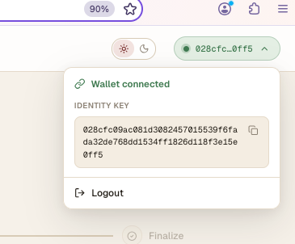

# Pagereader review feedback

The reader has a working foundation, but the paid-reading experience needs refinement and stronger verification. The goal is straightforward: understand the product, preview a book, approve wallet spending, read smoothly, and continue on another device.

This consolidates the original review, the technical corrections, and the additional product and design feedback. Confirmed issues are distinguished from behaviour that still needs testing. The code reviewed was commit `3f03e16`.

1. **Explain the product with a short hero above the library.**

   A new visitor should understand the benefit before encountering wallet terminology.

   Suggested copy:

   > **Pay for what you read, not the whole book.**
   >
   > Start with a free preview, then unlock pages as you go. No subscription or upfront book purchase. Return to pages you have already bought without paying again.
   >
   > **Start reading free**
   >
   > First two pages free. Paid pages cost 5 sats each, plus transaction fees.

   Keep this compact so visitors can quickly reach the books.

   Do not claim “pay directly to the author” yet. The current catalogue contains public-domain books, and payments go to the app’s receiving wallet. Direct author support can become part of the message when that payment distribution exists.

2. **Remove the app’s repeated purchase confirmation.**

   **Issue:** every page the app considers unowned opens another confirmation dialog, even after the user has granted the wallet a 5,000-sat allowance. This interrupts the core reading experience. See [App.tsx](app/client/src/App.tsx), the `request` function.

   **Fix:** show the payment explanation once, then let subsequent **Next** clicks request payment through the wallet. Keep the price visible on the button. The wallet should decide when another permission prompt is necessary.

   Remembering that the explanation was shown must not be treated as proof of wallet authorisation.

   **Verify:** several consecutive paid page turns produce no additional app confirmation. Wallet approval still appears when required, and cancellation behaves safely.

3. **Help readers install or open a wallet.**

   **Issue:** an unsuccessful wallet connection leaves the reader with a technical error and no useful setup guidance.

   **Fix:** include this in the first-use explanation and connection-error state:

   > **Need a wallet?** Download [BSV Desktop](https://desktop.bsvb.tech/) for your computer or [BSV Browser](https://mobile.bsvb.tech/) for your phone.
   >
   > Already installed? Open BSV Desktop, or open this reader inside BSV Browser, then try again.

   Show both options, prioritising the relevant device. Add **Try again**, preserve the current page, and keep free reading available without a wallet.

   Say “We couldn’t connect to your wallet” rather than asserting that it is not installed. The app may not know whether it is missing, closed or temporarily unavailable.

   The scaffold’s connection component still exists; it is unused by the reader, rather than deleted.

4. **Fix payment attempts that remain stuck after cancellation or failure.**

   **Issue:** the app records a payment attempt before asking the wallet to create the transaction. If that call fails, the attempt can remain in `preparing`. Subsequent attempts encounter the existing record and stop. The server also retains a purchase reservation.

   Relevant code: [payment-action.ts](spike/src/payment-action.ts), `preparePayment`, and [gateway.ts](app/client/src/reader/gateway.ts), the existing-attempt handling in `page`.

   **Fix:** distinguish a confirmed cancellation from an uncertain outcome. A definite refusal before transaction creation should have a safe retry path. If an unsigned action exists, confirm its cancellation before permitting replacement. If a transaction may have been signed or broadcast, recover that transaction instead of creating another.

   Coordinate the browser’s attempt record with the server’s reservation. Clearing only one side will leave inconsistent behaviour.

   Do not automatically expire uncertain attempts. A delayed wallet operation could still finish after the reservation expires, allowing two payments. Likewise, a stateless nonce does not by itself prevent duplicate spending or bind a payment to a particular page.

   **Verify:** cancellation, insufficient funds, wallet closure, delayed approval and lost responses all lead to an understandable recovery path without duplicate charges.

5. **Verify recovery when payment succeeds but saving the purchase fails.**

   **Issue:** the receiving wallet accepts the payment first; the application then saves the purchase in SQLite. Those are separate operations. A crash or database error between them could leave money received without a recorded entitlement.

   The receipt, entitlement and replay record are committed together locally, but that transaction does not include the wallet. See [probe.ts](spike/src/probe.ts), the `internalizeAction` wrapper.

   **Fix:** use the already-saved payment proof and transaction ID to reconcile an interrupted submission. Confirm the payment belongs to the correct identity, edition and page, then complete the missing purchase record without taking another payment.

   Handle the receiving wallet’s “already known” or duplicate-import behaviour explicitly. It must not prevent legitimate recovery or grant ownership of an unrelated transaction.

   **Verify:** simulate failure immediately after wallet acceptance and before receipt persistence. After restart, the original payment must unlock the page. Existing tests that mock wallet acceptance cannot establish this behaviour on their own.

6. **Preserve the fee cap and saved-payment protections.**

   **Issue:** the earlier suggestion to replace the custom flow with a simpler payment call would remove safeguards unless equivalent behaviour is provided elsewhere.

   The current sequence prepares the transaction, checks its actual fee, signs it, saves the proof, then broadcasts it. These are supported wallet operations. See [BRC-100 transaction options](https://bsv-blockchain.github.io/ts-stack/specs/brc-100-wallet/).

   **Fix:** retain those guarantees while improving the implementation. A wallet fee-rate setting is not equivalent to an absolute maximum fee: transaction size also affects the charge.

   Keep the distinction between the five-sat page price, transaction fees and any separate wallet-permission cost. Do not imply that the page fee cap also caps permission-creation costs.

   **Verify:** excessive or unknown fees stop the transaction before broadcast, and recovery reuses the original transaction.

7. **Check wallet allowances against the actual wallet versions being used.**

   **Issue:** the historical evidence describes a monthly allowance and an origin-label mismatch that caused some spending to be omitted from its accounting. This is separate from the app’s repeated confirmation dialog.

   **Fix:** record the Desktop and Browser versions used for testing, inspect the granted allowance, and verify spending attribution for the actual deployment origin. Check both ordinary spending and what happens when the allowance is exhausted.

   Describe the allowance using the wallet’s actual rules. Do not promise a session-only budget if the grant persists for a month.

   **Verify:** wallet history, allowance accounting and observed debits agree. Do not assume historical bugs remain present, or that a newer release repairs historical records.

8. **Measure paid-page latency before changing the architecture.**

   **Issue:** the historical sample was slow, but the evidence does not explain the whole delay. Counting wallet calls does not establish which operation caused it.

   **Fix:** measure wallet acquisition, authentication, transaction preparation, signing, broadcast, receiving-wallet processing, receipt persistence and display separately. Separate first-use performance from warm page turns and previously purchased pages.

   Use the existing instrumentation and [latency evidence](spike/evidence/latency-investigation-2026-10-17.md). Measure the required 20 paid turns per wallet and report the 95th percentile, which shows how slow the slower requests are.

   Investigate large payment proofs and supported known-transaction optimisations only after checking compatibility across the SDK, middleware and receiving wallet. Omitting required proof data is not a valid performance improvement.

   Paid prefetch must remain a separate opt-in decision because it can purchase pages the reader never opens.

9. **Make continuing a book obvious across devices.**

   **Issue:** a fresh device can start at page one while the server-side bookmark is hidden behind the Pages panel.

   **Fix:** provide a prominent **Continue reading** action. Once the wallet identity is available, retrieve its bookmark and ownership information. Keep ordinary library browsing and free previews wallet-free.

   Resume must use a read-only path. A saved page number must never become permission to purchase that page.

   **Verify:** the same wallet identity can resume the last displayed page on another device without paying again. Update bookmarks after successful display, not merely after clicking Next.

10. **Make spending understandable and accurately labelled.**

    **Issue:** the current counter shows cumulative spending for the selected book. It is not a session counter, and its technical wording is difficult to interpret.

    **Fix:** clearly label **This session** and **Total for this book** if both are needed. Keep confirmed spending visible and show pending or uncertain payments separately without silently dropping them.

    Keep a detailed breakdown available for page charges, verified fees and any excluded costs. An unknown fee must remain unknown rather than appear as zero. Continue deduplicating records by transaction ID.

    **Verify:** retries, reloads and device changes do not double-count spending or hide an unresolved payment.

11. **Replace technical errors with clear actions.**

    **Issue:** messages such as “Reconcile; do not pay again” expose implementation language without telling the reader what to do.

    **Fix:** provide a short explanation and an appropriate action. Examples:

    - “We couldn’t connect to your wallet.” → **Try again**
    - “Payment cancelled. Your current page is still available.” → **Try purchase again**, only when safe
    - “We couldn’t confirm whether the payment completed.” → **Check payment**
    - “New purchases are temporarily unavailable.” → explain that purchased pages remain accessible

    Keep technical diagnostics in logs. Do not say “We’re checking” unless a check is actually running, or promise “You weren’t charged” when the outcome is unknown.

12. **Develop a more distinctive visual identity.**

    The typography has a familiar AI-generated interface feel. That is acceptable for this version, but future iterations should feel more intentional and recognisably their own.

    Use AI-assisted design tools to explore ideas while developing your own design judgement. Study your favourite platforms, well-designed SaaS products and, especially, reading apps. Examine typography, spacing, hierarchy, navigation and payment interactions.

    Recognisable AI-generated visual patterns can make products feel interchangeable in an increasingly crowded market. For this reader, differentiation should come from comfortable reading, clear pricing, thoughtful details and unobtrusive controls.

    The market is saturated with lovable style / claude style apps. So overtime train your eye to know what that looks like, and add your own spin on it.

    Use claude design, but don't make it look like claude. Use references from your favourite SaaS platforms or similar use cases as universal good practices (we all know what looks and feels great as users) to what you are building, to continuously train your eye and separate from the saturated entry level audiences who can easily build websites/platforms

13. **Correct text formatting and the broken icon.**

    **Issue:** intended Gutenberg italics appear as literal underscores, and the wallet icon contains `¶` instead of `¶`.

    **Fix:** render supported emphasis safely, preserving literal underscores where appropriate. Avoid injecting untrusted HTML. Correct the malformed icon text and check encoding through the build.

    Prefer a presentation change for existing books. Do not silently change page boundaries or edition identities merely to improve formatting, because purchases refer to those editions and pages.

    **Verify:** representative passages render correctly on desktop and mobile, while existing purchased pages retain the same content boundaries.

14. **Fix the source-checksum failure without invalidating purchases.**

    **Issue:** all eight source files currently fail their stored hashes. Converting their line endings from LF to CRLF reproduces the expected hashes. The import process hashes original source bytes, so line-ending changes affect identity.

    **Fix:** preserve the source bytes matching the existing editions and configure Git to prevent unwanted conversion for those immutable assets. Keep the Linux shell-script line-ending rules separately.

    Do not simply replace the expected hashes or regenerate edition IDs. Purchases and bookmarks refer to the existing IDs. Future content revisions should create new editions while preserving access to old ones.

    Relevant code: [catalogue.test.ts](spike/test/catalogue.test.ts) and [import-catalogue.ts](spike/scripts/import-catalogue.ts).

    **Verify:** fresh checkouts on supported platforms produce identical hashes and preserve existing ownership.

15. **Separate production routes from research tools and add basic abuse controls.**

    **Issue:** the server serves the research interface, retains legacy API routes, exposes the shared configuration object through `/api/catalogue`, and has no application-level rate limiting.

    **Fix:** make research tooling an explicit development option, return only required public configuration, and limit expensive authentication and purchase-reservation requests. Consider both network-level and identity-level limits because identities are inexpensive to create.

    Keep payment recovery and owned-page delivery available when fresh purchases are paused. Document the purchase-admission switch clearly rather than deleting pause state to enable testing.

    Keep the receiving private key server-side and preserve the wallet state and purchase database during deployment. Changing the receiving identity or replacing the database requires a migration plan.

    Also document the payment-acceptance policy: pages currently unlock without waiting for mining confirmation. Wallet acceptance is not the same as confirmation on-chain.

16. **Reduce coupling to the research code and library implementation details.**

    **Issue:** production reader code imports directly from `spike/`. Wallet proxies intercept payment operations, and the server overrides `res.setHeader` to capture payment challenges. Large, compressed components also make review difficult.

    **Fix:** extract the proven payment, recovery and shared types into clearly owned modules. Keep research runners separate. Put library-specific behaviour behind a small adapter with explicit contracts.

    Preserve the existing safety behaviour during this refactor. Keep dependencies controlled and test challenge capture, payment acceptance, duplicate handling and recovery before upgrades.

    Format the code and split large UI components by responsibility. This should make the existing behaviour easier to inspect, rather than become a broad rewrite.

17. **Consolidate documentation and report status accurately.**

    **Issue:** useful findings are buried beneath historical checkpoints, and the original review sometimes treats missing evidence as a demonstrated defect.

    **Fix:** provide a short current-status document covering what works, known failures, unresolved tests, required setup and the next steps. Keep detailed evidence in linked appendices.

    Shorten the main learnings note to its intended sections. Describe historical wallet findings with dates and versions.

    Keep **implemented**, **locally tested**, **verified with a real wallet** and **verified across devices** distinct. Sharing the report was deferred for owner review; that should not be characterised as developer neglect.

18. **Prove the complete reading journey before declaring completion.**

    Test the full flow: wallet-free arrival and preview, wallet setup if needed, first purchase, uninterrupted paid reading, and resuming on a phone.

    Include cancellation, insufficient funds, delayed approval, lost responses, server restart, simultaneous tabs/devices, underpayment, and replay attempts against the wrong identity, page or edition.

    Confirm that purchased pages remain readable without another charge, spending stays accurate, and the intended performance target is measured on real paid requests. Use controlled, authorised mainnet runs for the cases that require spending.

    The last independent local run produced **62 passing tests and one checksum failure**. The full real-wallet recovery and desktop-to-phone experience remains unverified.
19. **Make the reader mobile-friendly and responsive.**

Test this flow using BSV Browser (Mobile)

The complete experience should work comfortably on phones, tablets and desktops, including the library, reading view, wallet setup, payments and error messages.

Adapt the layout: resize book cards, spacing and panels to fit smaller screens. Avoid horizontal scrolling, clipped text and overlapping controls.
Prioritise reading comfort: use readable typography, comfortable line spacing and suitable margins. Text-size changes should work without breaking the layout.
Make controls easy to tap: give navigation buttons generous touch targets and keep important actions accessible without covering the text.
Handle mobile screen boundaries: keep controls clear of notches, home indicators and browser toolbars. Dialogs should fit the screen and scroll when necessary.
Support mobile wallet setup: explain how to open the reader inside BSV Browser, with a clear download link and retry path.
Preserve purchased pages: changing screen size, orientation or font size must not change which content belongs to a paid page or trigger another purchase.
Test the whole journey: check narrow screens, portrait and landscape layouts, larger text, payment prompts, errors and bookmark recovery. Include real-device testing in BSV Browser.

Expected result: a reader can discover a book, preview it, pay and continue reading comfortably on a phone without zooming or struggling with the controls. (edited) 
[11:12 AM]Additional item:

20. **“Book total: 0 sats” means the app has recorded no spending for this book. It is not the price of the whole book. Since you’re viewing a free preview, zero could be correct.**

The label is ambiguous, though. Add this feedback separately:

Make the spending indicator clearer and reflect its actual state.

During a free preview, show “Free preview”. A zero-spend counter can be secondary.
Once spending begins, label it “Spent on this book: 6 sats”, with a breakdown of page charges and fees available when tapped.
Use a neutral colour for ordinary spending information. Red or orange makes zero spending look like a problem.
While retrieving purchase history, show “Loading spending…”. If retrieval fails, show “Spending unavailable”, rather than incorrectly displaying zero.
If session spending is also shown, label it separately from the cumulative book total.

Expected result: readers can immediately distinguish the page price, what they have spent, and whether that information is still loading.

If you have already purchased pages of Frankenstein using this wallet identity, the zero needs investigation as a receipt-loading or accounting issue. The bookmark error shown is a separate failure.

21. Add a wallet menu using the screenshot as the reference. (e.g. https://dynamic-supplychains.bsvb.tech )

Show connection status and a shortened public identity key in the header.
On click, display Wallet connected, the full public identity key, a Copy button and Log out.
When disconnected, show Connect wallet, with download guidance if needed.
Make the menu responsive and consistent with the reader’s design.

Logging out should clear the active session and displayed wallet information while preserving purchases and payment-recovery records. It does not revoke spending permissions saved in the wallet.

Expected result: readers can see whether their wallet is connected, identify which wallet they are using, and understand why their purchases or bookmarks may differ across devices.

